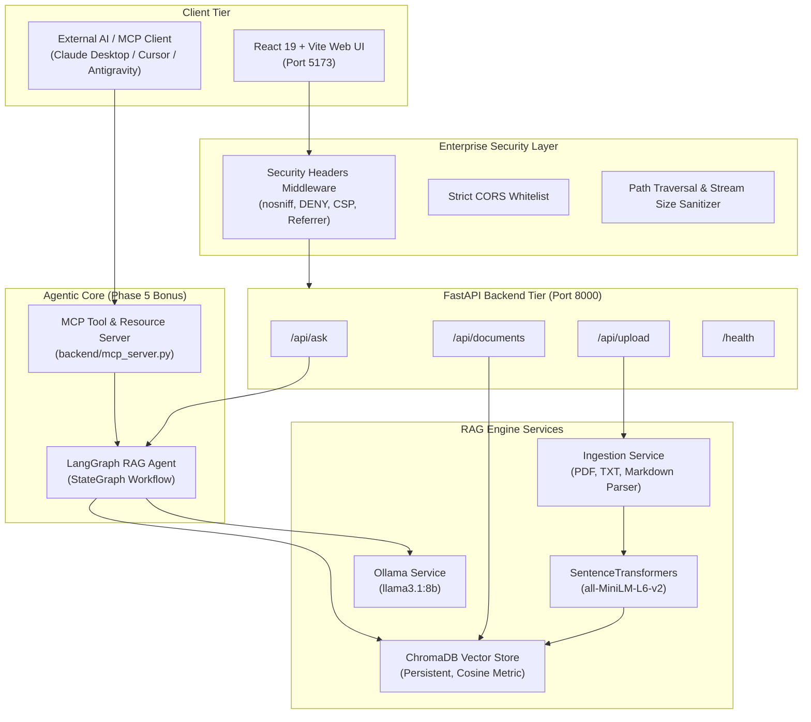
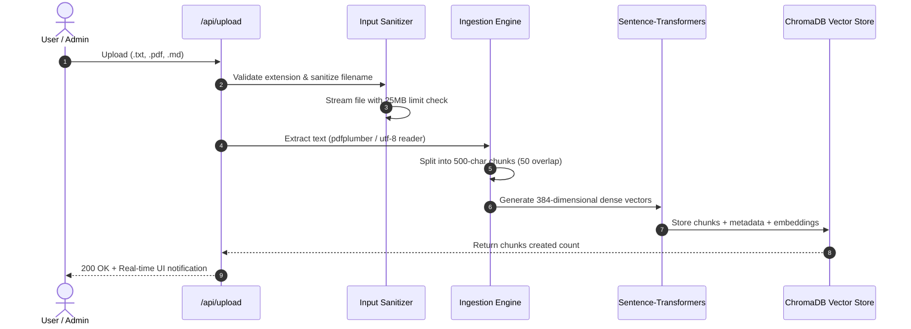
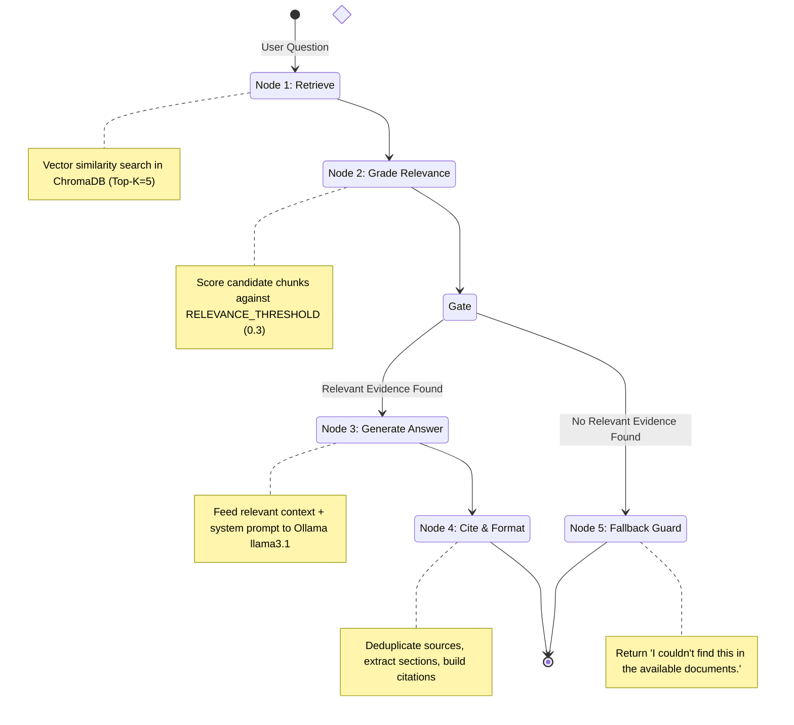
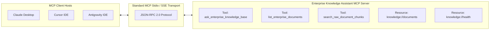

# 🧠 Intelligent Enterprise Knowledge Assistant

> **Grounded RAG Document Q&A System with LangGraph Agent Flow & Model Context Protocol (MCP)**  
> *Developed for the IEM × TCS Hackathon*

---

## 📋 Table of Contents

- [Overview & Problem Statement](#-overview--problem-statement)
- [System Architecture](#-system-architecture)
  - [High-Level Architecture](#high-level-architecture)
  - [Document Ingestion Pipeline](#document-ingestion-pipeline)
  - [LangGraph Agent Workflow (Phase 5 Bonus)](#langgraph-agent-workflow-phase-5-bonus)
  - [Model Context Protocol (MCP) Server](#model-context-protocol-mcp-server)
- [Technology Stack](#-technology-stack)
- [Phase-by-Phase Implementation](#-phase-by-phase-implementation)
  - [Phase 1: Scaffolding & Synthetic Enterprise Dataset](#phase-1--scaffolding--synthetic-enterprise-dataset)
  - [Phase 2: Ingestion Pipeline (Parse → Chunk → Embed → Store)](#phase-2--ingestion-pipeline-parse--chunk--embed--store)
  - [Phase 3: Retrieval Engine & Grounded Generation](#phase-3--retrieval-engine--grounded-generation)
  - [Phase 4: Modern React Web UI & Evidence Verification](#phase-4--modern-react-web-ui--evidence-verification)
  - [Phase 5 (Bonus): LangGraph Agentic RAG & MCP Server](#phase-5-bonus--langgraph-agentic-rag--mcp-server)
  - [Standard Secure Environment (Enterprise Hardening)](#standard-secure-environment-enterprise-hardening)
- [Enterprise Use Cases & Query Walkthrough](#-enterprise-use-cases--query-walkthrough)
- [Quick Start Guide](#-quick-start-guide)
  - [One-Click Launch (Windows)](#option-a-one-click-launch-windows)
  - [Manual Terminal Launch](#option-b-manual-terminal-launch)
  - [MCP Server Setup (Claude Desktop / Cursor)](#option-c-mcp-server-setup)
- [API Reference](#-api-reference)
- [Project File Structure](#-project-file-structure)
- [Hackathon Evaluation Criteria Alignment](#-hackathon-evaluation-criteria-alignment)

---

## 🎯 Overview & Problem Statement

In modern enterprise environments, company knowledge is scattered across hundreds of unstructured documents—HR policies, travel guidelines, IT security mandates, and remote work protocols. Employees waste valuable hours searching for answers or reading outdated handbooks.

While general-purpose LLMs can answer questions, **they hallucinate facts and cannot be trusted for strict corporate compliance**.

### The Solution:
The **Intelligent Enterprise Knowledge Assistant** implements a **strict, grounded Retrieval-Augmented Generation (RAG)** architecture that guarantees:
1. **100% Grounded Answers**: Responses are generated strictly using retrieved snippets from verified company documents.
2. **Mandatory Source Citations**: Every claim cites its exact source document and section (e.g. `(Source: Travel_Reimbursement_FAQ.txt, Section 2.1)`).
3. **Anti-Hallucination Fallback**: If a policy or fact is not in the knowledge base, the system explicitly refuses to guess and responds:  
   *"I couldn't find this in the available documents."*
4. **Interactive Evidence Drawer**: Users can inspect the exact raw chunks retrieved from the vector database, complete with cosine similarity match scores and one-click copy buttons.
5. **Agentic Decision Flow & MCP Support (Bonus)**: Implements a **LangGraph StateGraph** agent with relevance gating and exposes the entire system through an official **Model Context Protocol (MCP)** server.

---

## 🏛️ System Architecture

### High-Level Architecture



---

### Document Ingestion Pipeline



---

### LangGraph Agent Workflow (Phase 5 Bonus)

The system replaces naive one-shot retrieval with an auditable **LangGraph StateGraph**:



- **Auditable Execution Trace**: Every response returns a `workflow_steps` array (e.g. `["retrieve", "grade_relevance", "generate", "cite_and_format"]`), displayed in the UI badge.
- **Compute Savings**: Irrelevant queries bypass LLM generation entirely, resolving in milliseconds.

---

### Model Context Protocol (MCP) Server



---

## 🛠️ Technology Stack

| Component | Technology | Rationale & Selection Justification |
|---|---|---|
| **Local LLM** | **Ollama (`llama3.1:8b`)** | State-of-the-art open-weights model running 100% locally. Zero API costs, zero data leakage, and high compliance with system instructions. |
| **Embeddings** | **`sentence-transformers` (`all-MiniLM-L6-v2`)** | 384-dimensional dense vectors with exceptional semantic search quality, fast inference on CPU, and compact footprint. |
| **Vector Database** | **ChromaDB (Persistent)** | Embeddable, zero-external-dependency vector database using cosine distance metrics with local on-disk persistence. |
| **Backend Framework** | **FastAPI (Python 3.10+)** | High-performance asynchronous REST API with automatic OpenAPI Swagger documentation and Pydantic validation. |
| **Agentic Workflow** | **LangGraph (`StateGraph`)** | State-of-the-art framework for building cyclic, stateful multi-step agent flows with conditional branching and execution tracing. |
| **Tool Protocol** | **Model Context Protocol (MCP)** | Open industry standard (Linux Foundation / Anthropic) enabling any AI client to interact with our enterprise knowledge base. |
| **Frontend Framework** | **React 19 + Vite** | Blazing-fast hot module replacement, component-driven UI, and zero latency builds. |
| **Markdown Engine** | **`react-markdown`** | Renders AI answers with structured typography, ordered/unordered lists, code blocks, and blockquotes. |
| **UI Aesthetics** | **Vanilla CSS + Glassmorphism** | Custom dark theme with tailored HSL palettes, smooth micro-animations, and responsive layouts. |

---

## 🔍 Phase-by-Phase Implementation

### Phase 1 — Scaffolding & Synthetic Enterprise Dataset

**Goal:** Establish clean repository architecture and curate an authentic, multi-domain enterprise policy dataset.

#### Synthetic Document Catalog ([`backend/data/sample_docs/`](file:///d:/Projects/IEMxTCS%20Hackathon/backend/data/sample_docs))
The knowledge base comes pre-loaded with **5 comprehensive corporate documents** comprising **74 semantic chunks**:

| Document | Primary Domain | Key Topics Covered | Chunk Count |
|---|---|---|:---:|
| [`Employee_Handbook.txt`](file:///d:/Projects/IEMxTCS%20Hackathon/backend/data/sample_docs/Employee_Handbook.txt) | Company Culture & General Rules | Code of conduct, 6-month probation, work hours, meeting room etiquette, cafeteria guidelines | 14 chunks |
| [`HR_Policy.txt`](file:///d:/Projects/IEMxTCS%20Hackathon/backend/data/sample_docs/HR_Policy.txt) | HR & Employee Benefits | 12 days Casual Leave, 15 days Earned Leave, medical insurance (INR 5L), maternity/paternity leave, separation notice periods | 15 chunks |
| [`IT_Security_Policy.txt`](file:///d:/Projects/IEMxTCS%20Hackathon/backend/data/sample_docs/IT_Security_Policy.txt) | Information Security | 12-char password rules (90-day expiry), mandatory 2FA, data classification, clean desk policy, incident response | 19 chunks |
| [`Remote_Work_Policy.txt`](file:///d:/Projects/IEMxTCS%20Hackathon/backend/data/sample_docs/Remote_Work_Policy.txt) | Hybrid & Remote Guidelines | Eligibility (post-probation), core hours (10 AM - 4 PM), home office allowance (INR 25,000), monthly internet reimbursement (INR 1,500) | 14 chunks |
| [`Travel_Reimbursement_FAQ.txt`](file:///d:/Projects/IEMxTCS%20Hackathon/backend/data/sample_docs/Travel_Reimbursement_FAQ.txt) | Travel & Expense Guidelines | Domestic meal allowance (INR 1,500/day), international meals (USD 75/day), economy flights, client entertainment limits | 12 chunks |

---

### Phase 2 — Ingestion Pipeline (Parse → Chunk → Embed → Store)

**Goal:** Transform raw multi-format files into dense vector embeddings indexed for fast similarity search.

#### Technical Details ([`backend/app/services/ingestion.py`](file:///d:/Projects/IEMxTCS%20Hackathon/backend/app/services/ingestion.py)):
1. **Multi-Format Parsing**:
   - `.pdf`: Extracted page-by-page using `pdfplumber` with table/formatting preservation.
   - `.txt` / `.md`: Extracted via UTF-8 streaming readers.
2. **Semantic Sliding-Window Chunking**:
   - `CHUNK_SIZE = 500` characters.
   - `CHUNK_OVERLAP = 50` characters.
   - *Why overlap?* Prevents sentence truncation and ensures critical contextual transitions across chunk boundaries are preserved.
3. **Dense Vector Embeddings**:
   - Powered by `SentenceTransformerEmbeddingFunction("all-MiniLM-L6-v2")`.
   - Generates 384-dimensional normalized vector embeddings.
4. **Persistent Vector Indexing** ([`backend/app/services/vectorstore.py`](file:///d:/Projects/IEMxTCS%20Hackathon/backend/app/services/vectorstore.py)):
   - ChromaDB persistent collection configured with `{"hnsw:space": "cosine"}`.
   - Metadata attached to every vector: `source`, `chunk_index`, `section`, `char_length`.

---

### Phase 3 — Retrieval Engine & Grounded Generation

**Goal:** Retrieve top-matching evidence, enforce relevance thresholds, and generate strictly cited answers.

#### Technical Details ([`backend/app/services/retriever.py`](file:///d:/Projects/IEMxTCS%20Hackathon/backend/app/services/retriever.py), [`llm.py`](file:///d:/Projects/IEMxTCS%20Hackathon/backend/app/services/llm.py)):
1. **Semantic Similarity Query**:
   - Embeds query and retrieves top `TOP_K = 5` chunks.
   - Computes cosine similarity: $\text{similarity} = 1.0 - \text{distance}$.
2. **Relevance Gating**:
   - Filter candidate chunks with `RELEVANCE_THRESHOLD = 0.3`.
   - Prevents noisy or unrelated chunks from polluting the LLM prompt.
3. **Strict Persona & Anti-Hallucination Prompting**:
   ```
   You are an intelligent enterprise knowledge assistant for Acme Corporation.
   Answer employee questions using ONLY the provided document context.
   
   STRICT RULES:
   1. Answer ONLY based on the provided context. Do NOT use general knowledge.
   2. If the context does not contain enough information, respond EXACTLY with:
      "I couldn't find this in the available documents."
   3. Always cite the source document name: (Source: DocumentName, Section X.X)
   4. If multiple documents are relevant, cite all of them.
   ```
4. **Local LLM Execution**:
   - Queries Ollama local server (`http://localhost:11434`) using model `llama3.1`.

---

### Phase 4 — Modern React Web UI & Evidence Verification

**Goal:** Provide an intuitive interface where users can ask questions, verify citations, and manage the knowledge base.

#### UI Highlights ([`frontend/src/components/ChatWindow.jsx`](file:///d:/Projects/IEMxTCS%20Hackathon/frontend/src/components/ChatWindow.jsx), [`Sidebar.jsx`](file:///d:/Projects/IEMxTCS%20Hackathon/frontend/src/components/Sidebar.jsx)):
- **AI Output Line Breaks & Markdown**:
  - Implemented `ReactMarkdown` to format bullet lists (`- `), numbered lists (`1. `), bold text (`**`), and blockquotes.
  - Added CSS `white-space: pre-wrap; overflow-wrap: anywhere;` to prevent text squishing.
- **Intuitive Evidence & Sources Drawer**:
  - **Quick-Access Pills Bar**: Citation chips with document icons (`📕 PDF`, `📘 MD`, `📄 TXT`) and relevance badges.
  - **Color-Coded Match Scores**:
    - 🟢 `High Match` (≥ 80%)
    - 🟣 `Relevant` (≥ 60%)
    - 🟡 `Context` (< 60%)
  - **Evidence Cards**: Collapsible quotation cards with exact snippet text and a **one-click "📋 Copy Excerpt"** button.
- **Live Document Management**:
  - Drag-and-drop file upload zone.
  - Single-click deletion (🗑️ icon) with real-time vector purging.
  - Live heartbeat connection indicator (🟢 `Ollama Connected` / 🔴 `Ollama Offline`).

---

### Phase 5 (Bonus) — LangGraph Agentic RAG & MCP Server

**Goal:** Transform static retrieval into an agentic state machine and expose it to the broader AI ecosystem via MCP.

#### 1. LangGraph Agent Pipeline ([`backend/app/services/agent.py`](file:///d:/Projects/IEMxTCS%20Hackathon/backend/app/services/agent.py))
Built using `langgraph.graph.StateGraph` with typed `RAGAgentState`:
- **Nodes**:
  - `retrieve`: Retrieves candidate chunks from ChromaDB.
  - `grade_relevance`: Analyzes similarity scores and calculates peak relevance.
  - `_relevance_gate`: Conditional router branching to `generate` (if score $\ge 0.3$) or `no_answer` (if score $< 0.3$).
  - `generate`: Calls Ollama with curated context.
  - `cite_and_format`: Deduplicates citations and extracts section headers.
  - `no_answer`: Instant fallback without wasting LLM compute.
- **UI Agent Trace Badge**:
  Displays the step pipeline live on every message:
  ```
  ⚡ LangGraph Agent: 🔍 Retrieve → ⚖️ Grade Relevance → ✨ Generate → 📑 Cite & Format   Score: 71%
  ```

#### 2. Model Context Protocol (MCP) Server ([`backend/mcp_server.py`](file:///d:/Projects/IEMxTCS%20Hackathon/backend/mcp_server.py))
Exposes tools and resources using the official `mcp` 2.x SDK:
- **Tools**:
  - `ask_enterprise_knowledge_base(question: str)`: Grounded RAG Q&A with citations.
  - `list_enterprise_documents()`: Lists all indexed documents and chunk statistics.
  - `search_raw_document_chunks(query: str, top_k: int)`: Direct similarity search on ChromaDB.
- **Resources**:
  - `knowledge://documents`: Real-time JSON catalog of documents.
  - `knowledge://health`: System health and Ollama model status.

---

### Standard Secure Environment (Enterprise Hardening)

The backend includes comprehensive enterprise security controls:

1. **HTTP Security Headers Middleware** ([`backend/app/main.py`](file:///d:/Projects/IEMxTCS%20Hackathon/backend/app/main.py)):
   - `X-Content-Type-Options: nosniff` — Prevents MIME type sniffing.
   - `X-Frame-Options: DENY` — Eliminates clickjacking risks.
   - `X-XSS-Protection: 1; mode=block` — Cross-site scripting filter.
   - `Referrer-Policy: strict-origin-when-cross-origin` — Protects internal URLs.
   - `Permissions-Policy: camera=(), microphone=(), geolocation=(), payment=()` — Restricts browser APIs.
   - `Strict-Transport-Security` — Enabled in production.
2. **CORS Origin Whitelisting**: Restricted to trusted frontend origins defined in `.env`.
3. **Path Traversal Protection** ([`backend/app/routers/upload.py`](file:///d:/Projects/IEMxTCS%20Hackathon/backend/app/routers/upload.py)):
   - `sanitize_filename()` strips `../`, `..\`, null bytes, and shell characters.
   - Validates that canonical paths remain strictly inside the storage directory.
4. **File Size & Input Limits**:
   - Streaming validation enforces a strict **25MB maximum upload limit**.
   - Questions capped at **1,000 characters** to prevent prompt overflow DOS attacks.
5. **Config & Secrets Template**: Documented in [`backend/.env.example`](file:///d:/Projects/IEMxTCS%20Hackathon/backend/.env.example) with optional API Key authentication toggle.

---

## 💼 Enterprise Use Cases & Query Walkthrough

Test these queries in the chat interface to verify system accuracy:

### Use Case 1: HR & Leave Policy
- **Query:** *"How many casual leaves do employees get annually?"*
- **Grounded Answer:** Employees are entitled to 12 days of Casual Leave (CL) per calendar year.
- **Citation:** `(Source: HR_Policy.txt, Section 2.1)`
- **Agent Trace:** `Retrieve → Grade Relevance → Generate → Cite & Format`

### Use Case 2: IT Security & Compliance
- **Query:** *"What are the password requirements and expiration policy?"*
- **Grounded Answer:** Passwords must be at least 12 characters, include uppercase, lowercase, numbers, and special characters, and expire every 90 days.
- **Citation:** `(Source: IT_Security_Policy.txt, Section 2.1)`

### Use Case 3: Travel & Expense Reimbursement
- **Query:** *"What is the daily meal allowance for domestic travel?"*
- **Grounded Answer:** Domestic meal allowance is up to INR 1,500 per day.
- **Citation:** `(Source: Travel_Reimbursement_FAQ.txt, Chunk 1)`

### Use Case 4: Remote Work & Equipment
- **Query:** *"What is the one-time home office setup reimbursement amount?"*
- **Grounded Answer:** A one-time home office setup allowance of up to INR 25,000 is provided.
- **Citation:** `(Source: Remote_Work_Policy.txt, Section 4.2)`

### Use Case 5: Anti-Hallucination Fallback Test
- **Query:** *"What is the company stock ticker symbol?"* or *"What is the capital of Mars?"*
- **Expected Output:** *"I couldn't find this in the available documents."*
- **Agent Trace:** `Retrieve → Grade Relevance → Relevance Guard (Fallback)` *(LLM inference bypassed)*

---

## 🚀 Quick Start Guide

### Prerequisites
- **Python 3.10+** (with Anaconda or standard Python)
- **Node.js 18+**
- **[Ollama](https://ollama.ai)** installed and running with `llama3.1`:
  ```bash
  ollama pull llama3.1
  ```

---

### Option A: One-Click Launch (Windows)

Simply double-click:
```bat
start.bat
```
This launcher automatically:
1. Validates Python, Node.js, and Ollama.
2. Launches the **FastAPI Backend** on `http://localhost:8000` in a labeled console window.
3. Launches the **Vite React Frontend** on `http://localhost:5173` in a labeled console window.
4. Opens your default browser directly to [http://localhost:5173](http://localhost:5173).

To stop all services cleanly:
```bat
stop.bat
```

---

### Option B: Manual Terminal Launch

```bash
# Terminal 1: Make sure Ollama is active
ollama serve
ollama pull llama3.1

# Terminal 2: Start Backend
cd backend
python -m uvicorn app.main:app --reload --port 8000

# Terminal 3: Start Frontend
cd frontend
npm install
npm run dev
```

Visit [http://localhost:5173](http://localhost:5173) in your browser.

---

### Option C: MCP Server Setup

#### Test MCP Server Directly via CLI:
```bash
cd backend
python mcp_server.py --test
```

#### Connect to Claude Desktop or Cursor:
Add this configuration to your Claude Desktop config (`claude_desktop_config.json`):
```json
{
  "mcpServers": {
    "enterprise-knowledge-assistant": {
      "command": "python",
      "args": [
        "d:\\Projects\\IEMxTCS Hackathon\\backend\\mcp_server.py"
      ],
      "env": {
        "PYTHONUTF8": "1",
        "PYTHONIOENCODING": "utf-8"
      }
    }
  }
}
```

---

## 📡 API Reference

Interactive Swagger documentation is available at [http://localhost:8000/docs](http://localhost:8000/docs).

| Method | Endpoint | Description | Request Body | Response | Status Codes |
|---|---|---|---|---|:---:|
| `POST` | `/api/ask` | Ask question via LangGraph Agent or RAG pipeline | `{"question": "string", "use_agent": true}` | `{"answer": "...", "sources": [...], "is_grounded": true, "workflow_steps": [...]}` | 200, 400, 500 |
| `POST` | `/api/upload` | Upload document to knowledge base | Multipart Form (`file: PDF/TXT/MD`) | `{"filename": "...", "chunks_created": 15, "status": "success"}` | 200, 400, 413, 500 |
| `GET` | `/api/documents` | List all indexed documents & chunk counts | None | `{"documents": [...], "total_chunks": 74}` | 200 |
| `DELETE` | `/api/documents/{name}` | Delete document and purge its vectors | None | `{"filename": "...", "chunks_deleted": 15, "status": "deleted"}` | 200, 404 |
| `GET` | `/health` | Check backend & Ollama connection | None | `{"status": "healthy", "ollama_connected": true, ...}` | 200 |

---

## 📁 Project File Structure

```
IEMxTCS Hackathon/
├── start.bat                        # One-click Windows launcher
├── stop.bat                         # Clean shutdown script
├── .gitignore                       # Production-grade git exclusions
├── README.md                        # Project documentation (this file)
│
├── backend/
│   ├── app/
│   │   ├── main.py                  # FastAPI application & security middleware
│   │   ├── config.py                # Settings, thresholds, and sanitization helpers
│   │   ├── models/
│   │   │   └── schemas.py           # Pydantic request & response schemas
│   │   ├── services/
│   │   │   ├── vectorstore.py       # ChromaDB wrapper with cosine similarity
│   │   │   ├── ingestion.py         # Multi-format parser & chunking engine
│   │   │   ├── llm.py               # Ollama llama3.1 LLM service
│   │   │   ├── retriever.py         # Standard RAG retrieval orchestrator
│   │   │   └── agent.py             # LangGraph StateGraph Agent (Phase 5 Bonus)
│   │   └── routers/
│   │       ├── ask.py               # POST /api/ask router
│   │       ├── upload.py            # POST /api/upload router
│   │       └── documents.py         # GET/DELETE /api/documents router
│   ├── data/
│   │   ├── sample_docs/             # 5 corporate synthetic policy documents
│   │   └── uploads/                 # User-uploaded files (with .gitkeep)
│   ├── mcp_server.py                # Model Context Protocol (MCP) Server (Phase 5 Bonus)
│   ├── mcp_config.json              # MCP configuration template for Claude / Cursor
│   ├── requirements.txt             # Python dependencies
│   └── .env.example                 # Enterprise environment configuration template
│
└── frontend/
    ├── src/
    │   ├── App.jsx                  # Root React component & state orchestration
    │   ├── components/
    │   │   ├── ChatWindow.jsx       # Chat UI, ReactMarkdown, Evidence cards, Agent badge
    │   │   └── Sidebar.jsx          # Drag-and-drop uploader & document list
    │   ├── index.css                # Full glassmorphism design system
    │   └── main.jsx                 # Vite application entrypoint
    ├── index.html                   # HTML shell
    ├── package.json                 # Node dependencies
    └── vite.config.js               # Vite configuration
```

---

## 🏆 Hackathon Evaluation Criteria Alignment

| Evaluation Criterion | How Our Implementation Achieves It |
|---|---|
| **Answer Groundedness** | Strict system prompt rules, context-only answers, and zero external assumptions. |
| **Citation Accuracy** | Every answer explicitly cites source file and section; evidence panel reveals raw matching chunks. |
| **Hallucination Defense** | Negative constraint prompting + LangGraph relevance gating returns *"I couldn't find this"* when documents lack context. |
| **Engineering & Performance** | Chunk overlap prevents context loss; ChromaDB cosine search runs in sub-10ms; Ollama runs locally. |
| **Enterprise Security** | Industry-standard security headers (`nosniff`, `DENY`), path traversal guards, and file size limits. |
| **Modern UX / Aesthetics** | Polished glassmorphism dark theme, ReactMarkdown prose, copy buttons, and interactive source pills. |
| **Phase 5 Bonus: Agentic RAG** | LangGraph `StateGraph` with relevance gating and auditable execution steps displayed in the UI badge. |
| **Phase 5 Bonus: MCP Protocol** | Standardized Model Context Protocol server exposing tools and resources to external AI clients. |

---

*Built with ❤️ for the IEM × TCS Hackathon.*
